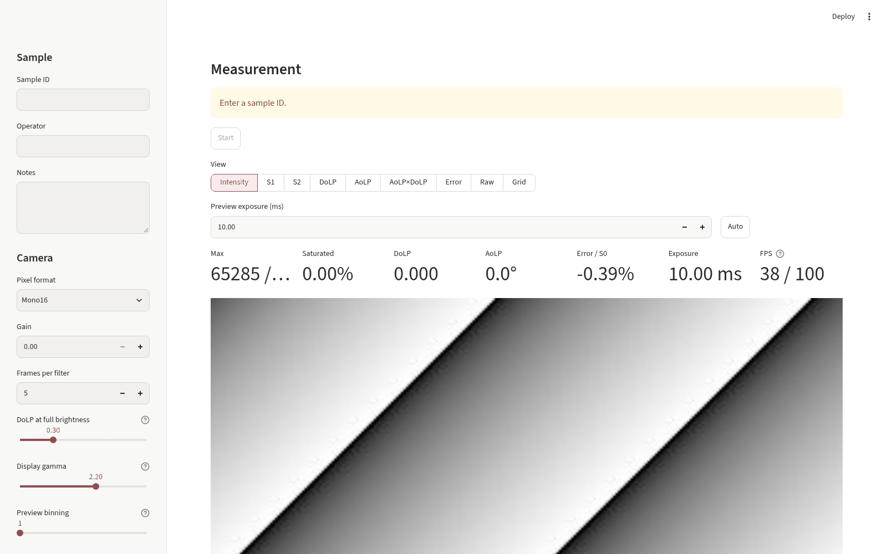
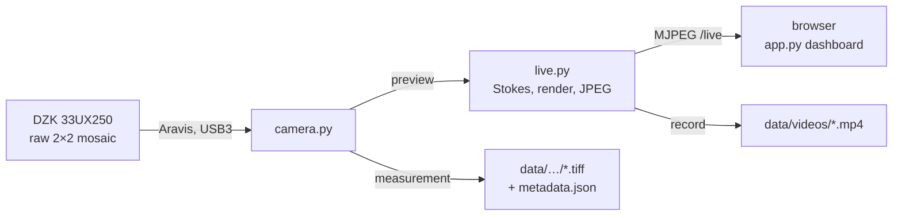

<div align="center">

# specpol

**Multispectral polarization imaging: see the polarization of light live, and measure it filter by filter.**

[](https://github.com/arunoruto/specpol/actions/workflows/docs.yml)
[](https://arunoruto.github.io/specpol/)

[](https://github.com/astral-sh/uv)
[](https://devenv.sh)

</div>

<p align="center">
  
  <br><sub>The dashboard, here with the simulated camera (<code>specpol --fake</code>)</sub>
</p>

specpol drives a polarization camera, The Imaging Source **DZK 33UX250** (Sony IMX250MZR,
2448×2048). In front of every pixel sits a tiny polarizer at 0°, 45°, 90° or 135°. From each 2×2
super-pixel specpol computes the **Stokes parameters** and shows, live in the browser, how strongly
(**DoLP**) and in which direction (**AoLP**) the light is polarized. Measurement runs step through
spectral filters and save raw frames with full metadata, for spectro-polarimetry of soil samples.

## Features

| | |
|---|---|
| 🎥 **Live preview** | Eight views (intensity, S1, S2, DoLP, AoLP, AoLP×DoLP, error, raw), any four side by side, up to ~35 fps, with an FPS counter and preview binning for slow links |
| 🧪 **Measurement runs** | Filter by filter, N frames each, raw TIFFs plus `metadata.json` written after every frame, auto exposure per filter |
| 🎞️ **Video snippets** | Record exactly what the preview shows as an H.264 MP4, one click |
| 🪞 **Visitor demo** | A German open-day view at `?demo` that tells the "polarizing sunglasses" story, mirrored like a mirror |
| 🌐 **One port** | Page and live images on the same port: works over Tailscale, SSH tunnels, proxies and through a single firewall rule |
| 🔓 **No vendor SDK** | The camera runs on [Aravis](https://github.com/AravisProject/aravis), the open-source USB3 Vision driver |
| 🧰 **No hardware needed to try it** | `specpol --fake` runs Aravis' simulated camera |

## How it works



The preview images are MJPEG streams served by Streamlit's own server: the browser updates them by
itself, without any page reruns, and slow links skip frames instead of queueing them. The details
are in the [architecture docs](https://arunoruto.github.io/specpol/architecture.html).

## Quick start

```sh
git clone https://github.com/arunoruto/specpol.git
cd specpol
devenv shell          # Aravis, Python, uv; or without devenv: nix run nixpkgs#devenv -- shell
specpol --fake        # simulated camera, no hardware needed
specpol               # real camera
```

Then open <http://localhost:8501>. Without Nix (e.g. Ubuntu), see
[installation](https://arunoruto.github.io/specpol/installation.html). The camera needs a udev rule
and a larger USB buffer, and other PCs need an open port:
[host setup](https://arunoruto.github.io/specpol/host-setup.html) has the commands for NixOS,
Ubuntu, Fedora and macOS.

## Documentation

📖 **<https://arunoruto.github.io/specpol/>**

| | |
|---|---|
| [Installation](https://arunoruto.github.io/specpol/installation.html) | Nix/devenv, Ubuntu, the `specpol` command |
| [Host setup](https://arunoruto.github.io/specpol/host-setup.html) | Camera access (udev, USB buffer), opening the firewall |
| [Using the dashboard](https://arunoruto.github.io/specpol/usage.html) | Views, metrics, measurement runs, video, demo |
| [Data and analysis](https://arunoruto.github.io/specpol/data.html) | File layout, Stokes analysis in Python, calibration |
| [Troubleshooting](https://arunoruto.github.io/specpol/troubleshooting.html) | Common errors and fixes |
| [Architecture](https://arunoruto.github.io/specpol/architecture.html) · [API](https://arunoruto.github.io/specpol/api.html) | How the preview works, performance, module reference |

## Analysis in Python

```python
import tifffile
from specpol import polar

raw = tifffile.imread("data/soil-01/2026-11-07_164600/open_000.tiff")
s = polar.stokes(raw)        # per super-pixel: s0, s1, s2, dolp, aolp, error
print(polar.mean_stokes(raw)["dolp"])
```

## Development

```text
src/specpol/   cli.py (the `specpol` command), server.py, app.py (dashboard),
               live.py (preview stream, video), camera.py (Aravis), polar.py (Stokes math)
tests/         pytest, against simulated cameras
docs/          Sphinx docs (Markdown via MyST), published by .github/workflows/docs.yml
```

```sh
uv run pytest                                                   # tests, no hardware needed
uv run --only-group docs sphinx-build docs docs/_build/html     # docs
```

## Roadmap

- [x] Live Stokes preview, measurement runs, video snippets, visitor demo
- [ ] **Filter wheel**: a measurement steps through all filters by itself after one button press
- [ ] Multispectral analysis across a run's filters
