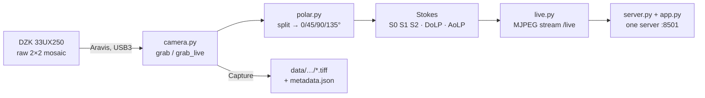

# DZK 33UX250 · Polarization Camera Dashboard

**See the polarization of light, live, and record soil-sample measurements with it.**

A Streamlit dashboard for The Imaging Source **DZK 33UX250** (Sony IMX250MZR, 2448×2048).
In front of every pixel sits a tiny polarizer at 0°, 45°, 90° or 135°. From each 2×2
super-pixel the dashboard computes the Stokes parameters and shows how strongly
(**DoLP**) and in which direction (**AoLP**) the light is polarized, live at up to ~35 fps.

- **Live preview**: eight views (intensity, S1, S2, DoLP, AoLP, AoLP×DoLP, error, raw), any four side by side
- **Measurement runs**: filter by filter, N frames each, raw TIFFs and full metadata written after every frame
- **Video snippets**: record what the preview shows as an MP4 (H.264), one click
- **Visitor demo**: a German, open-day view at `?demo` that tells the "polarizing sunglasses" story
- **No vendor SDK**: the camera runs on [Aravis](https://github.com/AravisProject/aravis), the open-source USB3 Vision driver
- **No hardware needed to try it**: `DZK_FAKE=1` runs a simulated camera



## Quick start

```sh
devenv shell          # or, without devenv installed: nix run nixpkgs#devenv -- shell
DZK_FAKE=1 app        # simulated camera
app                   # real camera (see "Host setup" below)
```

Open <http://localhost:8501>. The first `devenv shell` builds Aravis and syncs the Python
environment with uv, which takes a minute.

`app` runs `streamlit run server.py`: the dashboard (`app.py`) plus the live preview stream
(`live.py`, mounted at `/live/…`) on **one port, 8501**. Whatever reaches the page also reaches the
images: Tailscale (`tailscale0` is trusted), an SSH tunnel, a proxy, or the university network once
8501 is open in the firewall. `streamlit run app.py` alone shows the page without preview images.

## Host setup

### NixOS

The camera needs user access to its USB device and a usbfs buffer large enough for a
5 MP frame. The kernel default of 16 MB isn't enough. On `mayuri` this is already in
`~/.config/flake/systems/x86_64-linux/mayuri/default.nix`. For another host, add:

```nix
boot.kernelParams = [ "usbcore.usbfs_memory_mb=1000" ];
services.udev.extraRules = ''
  SUBSYSTEM=="usb", ATTRS{idVendor}=="199e", MODE="0660", GROUP="video", TAG+="uaccess"
'';
```

Then switch, **replug the camera** (udev rule), and **reboot** (kernel parameter). To apply the
buffer size without rebooting:

```sh
echo 1000 | sudo tee /sys/module/usbcore/parameters/usbfs_memory_mb
```

Check that it worked:

```sh
cat /sys/module/usbcore/parameters/usbfs_memory_mb   # 1000
arv-tool-0.8                                         # The Imaging Source Europe GmbH-199E…-… (USB3)
```

### macOS

Nothing to configure: plug in the camera and run as above (needs Nix).

## Using the dashboard

### Live preview

| View | Shows |
|---|---|
| **Intensity** | S0, the normal camera image |
| **S1 / S2** | 0°–90° and 45°–135° differences (mid-grey = 0) |
| **DoLP** | Degree of linear polarization, black 0 → white 1 |
| **AoLP** | Angle of linear polarization as hue (red 0°, green 60°, blue 120°) |
| **AoLP×DoLP** | Hue = angle, brightness = degree. Usually the most telling view |
| **Error** | (I0+I90) − (I45+I135). Zero for ideal polarizers, so it shows noise and artifacts |
| **Raw** | The full-resolution sensor mosaic |
| **Grid** | Any four views or single-angle images (I0, I45, I90, I135) at once |

The metrics row shows the max pixel value, the saturated fraction, frame-average DoLP and
AoLP, the error ratio, and **FPS** (frames reaching this browser / what the camera can deliver at
this exposure and format: Mono16 ≤ 37.5, Mono8 ≤ 75). Use it with **Auto** (brightest pixels to
~80% of full scale) to pick exposures.

Sidebar display settings change only the preview, never the saved data:

- **AoLP×DoLP full-brightness DoLP**: lower it for weakly polarized scenes.
- **Gamma**: brightens shadows and midtones.
- **Preview binning** (1/2/4): averages n×n super-pixels. n× less noise, 1/n resolution, and much
  faster: about 35 fps at 2 and 4 against ~17 at 1, with a fifth of the data at 2 (best over Tailscale).

### Video snippet

Sidebar **Video**: pick a length (1–30 s) and press **Record**. It records exactly what the page
shows (view or grid, binning, gamma, mirroring) as an H.264 MP4 with real-time timestamps, saved
to `data/videos/<YYYY-MM-DD_HHMMSS>_<views>.mp4` and offered as a download. The frame rate is the
preview's (e.g. ~30 fps for one view at bin 2, ~19 fps for a four-image grid). It's for showing,
not analysis: use a measurement run for raw data.

### Measurement run

1. In the sidebar, enter a **sample ID** (required), operator and notes. Pick the pixel format
   (Mono16 is the default), gain and frames per filter.
2. Fill the **filter table**: name, wavelength and exposure, one row per filter in capture order.
   Add a `dark` row (lens capped) for dark frames. The table is saved to `filters.json` and
   restored next time.
3. Press **Start**. For each step, insert the filter it asks for, optionally **Auto-expose**, then
   press **Capture**. **Abort** keeps everything captured so far.

### Visitor demo

Open <http://localhost:8501/?demo>. It's a German, sidebar-free view with explanatory text and
a fixed four-image grid (normal image, 0° polarizer, 90° polarizer, AoLP×DoLP). It has no
measurement controls.

| Parameter | Effect |
|---|---|
| `?demo` | Demo view, mirrored like a mirror (with polarization angles flipped to match) |
| `&cols=4` | All four images in one row, for 21:9 screens |
| `&mirror=0` | Turn mirroring off (or `?mirror=1` to mirror outside the demo) |
| `&bin=2` | Average 2×2 super-pixels: faster, less noise, half resolution |

## Data layout

```
data/<sample>/<YYYY-MM-DD_HHMMSS>/
  metadata.json          # sample, operator, notes, camera, settings, filters, polarizer pattern,
                         # every frame's actual settings, started/finished/aborted
  <filter>_000.tiff      # raw mosaic, uint8/uint16; the frame's JSON is also in the TIFF description
data/videos/<YYYY-MM-DD_HHMMSS>_<views>.mp4   # video snippets
```

`metadata.json` is rewritten after every frame, so a crash never loses frames that are
already on disk. Each frame's settings are read back from the camera (exposure, gain,
pixel format, sensor temperature) rather than taken from what was requested.

### Analysis

```python
import tifffile, polar

raw = tifffile.imread("data/soil-01/2026-11-07_164600/open_000.tiff")
s = polar.stokes(raw)          # per super-pixel: s0, s1, s2, dolp (0..1), aolp (deg, -90..90), error
m = polar.mean_stokes(raw)     # same, for the whole frame (or a crop): floats
low_noise = polar.from_intensities(polar.split(raw, n=2))  # 2×2 binned
```

### Calibrate the polarizer pattern once

`PATTERN` in `polar.py` maps each 2×2 position to its polarizer angle. ROI offsets or
ReverseX/Y can shift it. Point the camera through a linear polarizer at 0°: **AoLP should read ~0°**.
If it reads 90° or ±45°, swap the entries.

## Troubleshooting

| Symptom | Cause / fix |
|---|---|
| `No camera found` | Check the cable. Is `ls -l /dev/bus/usb/*/*` group `video` for the camera? If not, the udev rule isn't active: switch and replug |
| `Frame failed … size-mismatch` | usbfs buffer still at 16 MB, see [Host setup](#nixos) |
| `LIBUSB_ERROR_BUSY` | Another process has the camera, usually a second `app` or a script. Only one can open it at a time |
| Page loads but the preview images stay empty | Started with `streamlit run app.py` instead of `server.py` (`app` does it right). Check `curl -s -o /dev/null -w "%{http_code}" http://<host>:8501/live/x/0`: 404 = route there |
| Page doesn't load from another PC in the pool | Port 8501 is closed on the university network (only Tailscale is trusted on mayuri): open it in the firewall |

## Project layout

| File | |
|---|---|
| `server.py` | Entry point (`streamlit run server.py`): `app.py` plus the `/live` stream routes on the same server |
| `app.py` | Streamlit dashboard: preview, demo, measurement runs |
| `live.py` | Preview stream: one capture thread, frames rendered once per browser session and pushed as MJPEG at `/live/<session>/<slot>`, slow links drop frames instead of queueing them. Also records video snippets |
| `camera.py` | Aravis wrapper. `grab` = one guaranteed-fresh frame (for measurements), `grab_live` = continuous stream (~30 fps on USB3, for preview) |
| `polar.py` | Mosaic split, binning and Stokes math |
| `test_polar.py`, `test_camera.py` | `uv run python test_polar.py` / `uv run python test_camera.py` |
| `devenv.nix` | Aravis, GObject introspection and Python via uv. `app` script |
